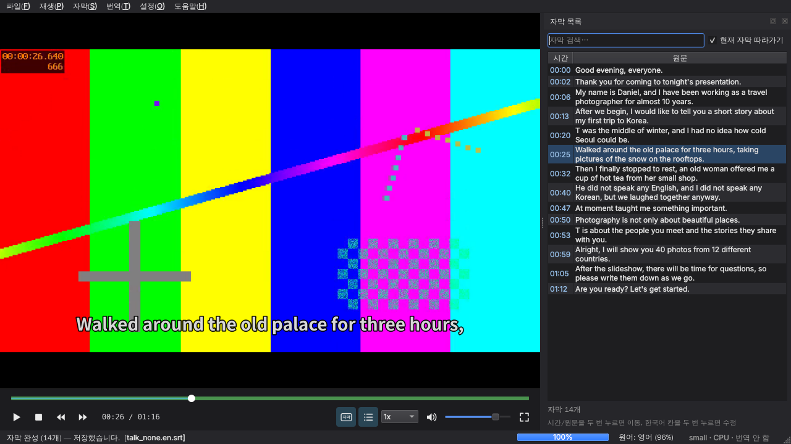

# 한글자막 플레이어 (KoSub Player)

동영상을 **재생하면 그 영상의 음성을 알아듣고 한국어 자막을 만들어 화면에 보여 주고, `.srt` 파일로 자동 저장**하는 데스크톱 동영상 플레이어입니다.

- 🎬 **재생과 동시에 자막 생성**: 영상을 열면 바로 재생되고, 재생 중인 위치부터 먼저 자막을 만듭니다. 중간으로 건너뛰면 그 위치부터 다시 우선 처리합니다.
- 🌏 **원본 언어 자동 감지**: 영어, 일본어, 중국어, 스페인어 등 99개 언어. 한국어 영상은 번역 없이 한국어 자막만 만듭니다.
- 🇰🇷 **한국어 번역**: 구글 번역(무료, 키 불필요) 또는 Claude AI(문맥을 고려한 자연스러운 번역, API 키 필요).
- 💾 **자동 저장**: 몇 초마다 `영상이름.ko.srt`(한국어), `영상이름.en.srt`(원어) 파일을 영상과 같은 폴더에 저장합니다. 팟플레이어·VLC·곰플레이어 같은 다른 플레이어에서도 자동으로 인식됩니다.
- ⏯ **이어서 만들기**: 중간에 닫아도 다음에 열면 남은 부분만 이어서 만듭니다. 이미 완성된 영상은 저장된 자막을 바로 불러옵니다.
- ✏️ **자막 목록·수정**: 오른쪽 목록에서 원문과 번역을 함께 보고, 두 번 눌러 해당 장면으로 이동하거나 번역을 직접 고칠 수 있습니다(바로 파일에 저장).
- 🖥 **완전 로컬 음성 인식**: [faster-whisper](https://github.com/SYSTRAN/faster-whisper)(OpenAI Whisper)를 내 컴퓨터에서 실행합니다. NVIDIA GPU가 있으면 자동으로 사용합니다.



*실제 실행 화면: 영어 음성 테스트 영상을 `small` 모델(CPU)로 인식한 모습입니다. 이 캡처는 '번역 안 함' 모드라 원문 자막만 보이며, 기본 설정(구글 번역)에서는 화면에 한국어 자막이, 목록에는 한국어 열이 함께 표시됩니다.*

탐색 막대의 **초록색은 자막이 만들어진 구간**, **노란색은 지금 만들고 있는 구간**입니다.

---

## 설치와 실행

### Windows

1. [Python 3.10 이상](https://www.python.org/downloads/)을 설치합니다. 설치 첫 화면에서 **"Add python.exe to PATH"를 꼭 체크**하세요.
2. 이 폴더(`subtitle_player`)의 **`run_windows.bat`을 더블클릭**합니다.
   - 처음 한 번은 필요한 패키지를 설치하느라 몇 분 걸립니다.
   - 다음부터는 바로 플레이어가 열립니다.
3. 동영상 파일을 창에 끌어다 놓거나 `Ctrl+O`로 엽니다.

> 처음 자막을 만들 때 음성 인식 모델(기본 `small`, 약 480MB)을 한 번 내려받습니다. 상태 표시줄에 진행률이 보입니다.

### macOS / Linux

```bash
cd subtitle_player
./run.sh            # 처음 실행 시 .venv를 만들고 패키지를 설치합니다
./run.sh 영상.mp4   # 파일을 열면서 실행
```

직접 설치하려면:

```bash
python3 -m venv .venv
.venv/bin/pip install -r requirements.txt
.venv/bin/python main.py
```

Linux에서 화면 라이브러리 오류(`libEGL.so.1` 등)가 나면 `sudo apt install libegl1 libgl1 libxkbcommon0 libfontconfig1 libpulse0` 를 설치하세요.

---

## 사용법

| 동작 | 방법 |
|---|---|
| 동영상 열기 | 창에 끌어다 놓기, `Ctrl+O`, 파일 → 최근 파일 |
| 재생 / 일시정지 | `Space`, 화면 한 번 클릭 |
| 5초 / 30초 이동 | `←` `→` / `Ctrl+←` `Ctrl+→` |
| 이전 / 다음 자막으로 | `A` / `D` |
| 볼륨, 음소거 | `↑` `↓`, 마우스 휠 / `M` |
| 재생 속도 | `[` `]`, `Backspace`(보통 속도) |
| 전체 화면 | `F`, 화면 두 번 클릭 / `Esc` |
| 자막 켜기·끄기 / 원문 함께 보기 | `C` / `V` |
| 자막 목록 | `L` |
| 자막 크기 | `Ctrl` + `+` / `-` |
| 자막 만들기(이어서) | `Ctrl+G` |

**자막 메뉴**

- **자막 만들기 / 이어서 만들기**: 자동 생성을 꺼 두었거나 멈춘 작업을 이어서 진행합니다.
- **번역 다시 하기**: 음성 인식 결과는 그대로 두고, 현재 번역 설정(예: 구글 → Claude)으로 다시 번역합니다. 직접 고친 번역은 유지됩니다.
- **처음부터 새로 만들기**: 저장된 결과를 지우고 다시 만듭니다.

이미 `영상이름.ko.srt` 파일이 있는 영상(다른 곳에서 받은 자막 등)은 새로 만들지 않고 그 파일을 불러와 보여 줍니다. 새로 만들려면 *자막 → 처음부터 새로 만들기*를 누르세요.

### 저장되는 파일

| 파일 | 내용 |
|---|---|
| `영상이름.ko.srt` | 한국어 자막 (UTF-8, 다른 플레이어 호환) |
| `영상이름.en.srt` | 원어 자막 (언어 코드는 감지된 언어: `ja`, `zh` …) — 설정에서 끌 수 있음 |
| `영상이름.ko+en.srt` | 이중 자막(한국어 + 원문) — 설정에서 켤 수 있음 |

영상 폴더에 쓸 수 없으면(읽기 전용 USB 등) 앱 데이터 폴더의 `subtitles`에 저장합니다. *파일 → 자막 폴더 열기*로 바로 열 수 있습니다.

---

## 설정 (설정 → 환경설정)

### 음성 인식 모델

| 모델 | 크기 | 특징 |
|---|---|---|
| `tiny` | 75MB | 가장 빠름, 정확도 낮음 |
| `base` | 145MB | 빠름 |
| **`small`** | 480MB | **CPU 기본값**, 속도와 정확도 균형 |
| `medium` | 1.5GB | 정확, CPU에서는 느림 |
| **`large-v3-turbo`** | 1.6GB | **GPU 기본값**, 매우 정확하고 빠름 |
| `large-v3` | 3GB | 최고 정확도, 가장 느림 |

- *자동*으로 두면 NVIDIA GPU가 있으면 `large-v3-turbo`, 없으면 `small`을 씁니다.
- 처리 속도가 재생보다 느리면(상태 표시줄의 "N배속"이 1보다 작으면) 더 작은 모델을 고르세요. 자막은 재생 위치를 따라가며 만들어지고, 빠진 부분은 나중에 채워집니다.
- 원본 언어를 알고 있다면 *원본 언어*를 직접 지정하면 더 정확합니다.

### GPU(NVIDIA) 사용

NVIDIA 드라이버가 설치된 PC에서 아래 패키지를 추가로 설치하면 GPU로 훨씬 빠르게 인식합니다.

```bash
.venv\Scripts\pip install nvidia-cublas-cu12 "nvidia-cudnn-cu12==9.*"     # Windows
.venv/bin/pip install nvidia-cublas-cu12 "nvidia-cudnn-cu12==9.*"         # Linux
```

GPU 초기화에 실패하면 플레이어는 꺼지지 않고 자동으로 CPU로 전환합니다(음성 인식은 별도 프로세스에서 돌기 때문).

### 번역

- **구글 번역 (기본값)**: 무료이고 설정이 필요 없습니다. 인터넷 연결이 필요합니다.
- **Claude AI**: 앞뒤 문맥, 말투(반말/존댓말), 이름을 일관되게 고려해서 자막답게 번역합니다.
  1. [console.anthropic.com](https://console.anthropic.com/)에서 API 키를 발급합니다(사용량만큼 과금).
  2. *환경설정 → 번역*에서 *Claude AI*를 고르고 키를 입력합니다. 키를 비워 두면 `ANTHROPIC_API_KEY` 환경 변수를 씁니다.
  3. 모델은 기본값 *Claude Opus 5.5*(최고 품질)이고, 비용을 줄이려면 Sonnet 5.5 / Haiku 5.5를 고를 수 있습니다.
  - 요청이 안전 정책 분류기에 걸려 거절되면 서버가 기본 대체 모델로 자동 재시도하도록(`fallbacks: "default"`) 설정되어 있습니다.
- **번역 안 함**: 원래 언어 자막만 만듭니다.

번역에 실패한 줄은 잠시 후 자동으로 다시 시도하고, 끝까지 실패하면 원문으로 저장한 뒤 다음에 영상을 열 때 이어서 번역합니다.

---

## 명령줄로 여러 영상 한꺼번에 만들기

창을 띄우지 않고 자막만 만들 수 있습니다. 설정 창에서 저장한 설정을 기본으로 씁니다.

```bash
python main.py --cli 영상1.mp4 영상2.mkv
python main.py --cli *.mp4 --model large-v3-turbo --device cuda
python main.py --cli 강의.mp4 --language en --translator claude --bilingual
python main.py --cli --help      # 모든 옵션
```

---

## 데이터 위치

| OS | 폴더 |
|---|---|
| Windows | `%APPDATA%\KoSubPlayer` |
| macOS | `~/Library/Application Support/KoSubPlayer` |
| Linux | `~/.local/share/KoSubPlayer` |

- `settings.json` 설정 (Claude API 키도 여기에 저장됩니다)
- `models/` 내려받은 음성 인식 모델 — 지우면 다음에 다시 내려받습니다
- `jobs/` 영상별 작업 기록(이어서 만들기용). 영상 이름을 바꾸거나 옮겨도 같은 영상으로 인식합니다
- `logs/` 오류가 나면 `worker.log`, `app.log`를 확인하세요 (*도움말 → 로그 폴더 열기*)

---

## 문제 해결

- **"모델을 내려받지 못했습니다"**: 인터넷 연결과 `huggingface.co` 접속을 확인하세요. 회사망이라면 방화벽 때문일 수 있습니다.
- **영상은 나오는데 자막이 늦게 나와요**: 처음에는 모델 로딩에 몇 초 걸립니다. 계속 느리면 더 작은 모델이나 GPU를 쓰세요.
- **자막이 엉뚱한 언어로 나와요**: *환경설정 → 음성 인식 → 원본 언어*를 직접 지정한 뒤 *자막 → 처음부터 새로 만들기*를 누르세요.
- **번역이 안 돼요(구글)**: 짧은 시간에 요청이 너무 많으면 잠시 막힐 수 있습니다. 자동으로 다시 시도합니다.
- **재생이 안 되는 파일**: 재생은 Qt(FFmpeg)가 담당합니다. 재생이 안 되더라도 자막 파일은 만들어질 수 있습니다.

---

## 개발자용

```
subtitle_player/
├── main.py                 실행 파일 (GUI / --cli / --worker)
├── kosub/
│   ├── engine.py           자막 작업: 재생 위치 우선 구간 선택 → 인식 → 문장 분할 → 번역 → 자동 저장
│   ├── audio.py            PyAV로 필요한 구간만 16kHz로 디코딩, 무음 지점 찾기
│   ├── transcriber.py      faster-whisper 래퍼 (모델 다운로드 진행률, GPU 감지)
│   ├── segmentation.py     단어 타임스탬프 기반 문장/자막 줄 나누기
│   ├── translators.py      구글 번역 / Claude 번역
│   ├── subtitles.py        자막 큐 생성, 줄바꿈, SRT 읽기/쓰기
│   ├── jobstore.py         작업 상태(JSON) 저장, 자막 파일 출력
│   ├── worker.py           음성 인식 워커 프로세스 (GUI와 JSON 줄 단위 통신)
│   └── ui/                 PySide6 화면 (플레이어, 자막 오버레이, 탐색 막대, 자막 목록, 설정)
└── tests/                  pytest 테스트
```

테스트 (모델 없이 가짜 인식기로 전체 흐름을 검사):

```bash
pip install pytest
python -m pytest -q
```

`KOSUB_FAKE=1` 환경 변수를 주면 모델을 내려받지 않고 가짜 인식기/번역기로 플레이어를 띄워 볼 수 있습니다.
